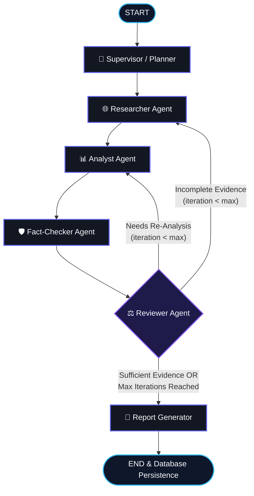
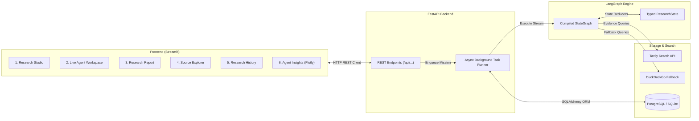

# AgentVerse — Multi-Agent Research & Intelligence System

[](https://www.python.org/)
[](https://fastapi.tiangolo.com/)
[](https://langchain-ai.github.io/langgraph/)
[](https://streamlit.io/)
[](https://www.postgresql.org/)
[](https://opensource.org/licenses/MIT)

**AgentVerse** is an autonomous, evidence-backed research intelligence platform powered by a genuine multi-agent stateful workflow built with **LangGraph**, **FastAPI**, **PostgreSQL**, and **Streamlit**. 

When given a complex technology trend, market dynamic, or scientific inquiry, a team of six specialized autonomous agents collaborates to decompose objectives, retrieve web evidence, deduplicate canonical sources, synthesize thematic trends, audit factual assertions, perform peer review with bounded revision loops, and publish executive-grade intelligence reports with traceable citations.

---

## 📌 Problem Statement

Traditional single-prompt LLM research suffers from three critical failure modes:
1. **Hallucination & Fake Citations**: LLMs generate plausible-sounding URLs, publication dates, and empirical statistics that do not exist.
2. **Superficial Synthesis**: A single prompt cannot deeply explore multi-faceted problems requiring separate decomposition, empirical retrieval, and critical peer review.
3. **Unbounded Agent Loops**: Unconstrained agent architectures risk infinite loops, uncontrolled API costs, and drift from the original inquiry.

**AgentVerse solves this** by orchestrating six specialized, single-responsibility agents inside a strictly bounded, cyclic **LangGraph StateGraph** that maps assertions to canonical source metadata, audits contradictions, and enforces maximum review cycles.

---

## 🏛️ Multi-Agent Architecture

AgentVerse does not use sequential prompt chaining. Each agent operates as a specialized node in a strongly typed shared state graph:



### Specialized Agents & Roles

| Agent | Icon | Core Responsibility | Structured Output |
| :--- | :---: | :--- | :--- |
| **Supervisor** | 🧠 | Analyzes prompt domain, breaks question into 3–6 prioritized subtopics, and plans targeted web search queries. | `SupervisorPlanOutput` |
| **Researcher** | 🌐 | Queries search providers (Tavily / DuckDuckGo), retrieves web articles, normalizes canonical URLs, and deduplicates evidence. | `ExtractedEvidence` |
| **Analyst** | 📊 | Deeply analyzes corpus, isolates directly supported facts from projections, identifies market trends, opportunities, and research gaps. | `AnalystOutput` |
| **Fact-Checker** | 🛡️ | Cross-references claims against source corpus, marks claims as `supported`, `partially_supported`, `contradicted`, or `unverified`, and flags conflicting data. | `FactCheckerOutput` |
| **Reviewer** | ⚖️ | Audits completeness and citation coverage, deciding whether to route for targeted research cycles or proceed to publication. | `ReviewerOutput` |
| **Report Generator**| 📄 | Synthesizes an executive markdown report with numbered in-text citations linked directly to verified external URLs. | `ReportGeneratorOutput` |

---

## ⚡ System Architecture



---

## 🗄️ Database Schema

The database model is implemented using **SQLAlchemy** and supports both **PostgreSQL** (production & Docker) and **SQLite** (local zero-config development):

1. **`research_jobs`**: Master record tracking research question, execution status (`queued`, `planning`, `researching`, `analyzing`, `fact_checking`, `reviewing`, `generating_report`, `completed`, `cancelled`), depth, iteration count, and timestamps.
2. **`research_tasks`**: Granular subtopics planned by the Supervisor with priority rankings and agent assignments.
3. **`research_sources`**: Deduplicated evidence sources containing canonical URLs, title, domain, published date, relevance scores, and stable citation numbers `[1]`, `[2]`.
4. **`research_claims`**: Audited factual claims with verification status (`supported`, `partially_supported`, `contradicted`, `unverified`), confidence score, and supporting source IDs.
5. **`agent_execution_logs`**: Telemetry timeline capturing execution time (seconds), input/output summaries, and error logs for every agent invocation.
6. **`research_reports`**: Published executive reports containing executive summary, methodology, key findings, risks/opportunities, limitations, and JSON citations.

---

## 💻 Tech Stack

- **Backend**: Python 3.11+, FastAPI, LangGraph, LangChain, Pydantic v2, SQLAlchemy 2.0, Uvicorn
- **LLM Engine**: OpenAI API (`gpt-4o-mini` / `gpt-4o`) with an intelligent, deterministic offline `MockLLM` fallback for isolated environments
- **Search & Scraping**: Tavily Search API, DuckDuckGo Search, HTTPX, BeautifulSoup4
- **Database**: PostgreSQL 16 (with automatic local SQLite fallback)
- **Frontend**: Streamlit, Custom Dark Charcoal Editorial CSS, Plotly Analytics
- **Document Export**: FPDF2 for publication-ready PDF reports
- **Testing**: Pytest, Pytest-Asyncio, HTTPX

---

## 🚀 Quickstart & Setup

### 1. Prerequisites
- Python 3.11+
- Git

### 2. Clone and Setup Environment
```bash
git clone https://github.com/your-username/Agentverse.git
cd Agentverse

# Copy environment template
cp .env.example .env
```

Edit `.env` to configure your API keys (optional if running in test/mock mode):
```env
OPENAI_API_KEY=your_openai_api_key_here
TAVILY_API_KEY=your_tavily_api_key_here
DATABASE_URL=sqlite:///./agentverse.db
SEARCH_PROVIDER=auto
```

*(Note: If no API keys are provided, AgentVerse automatically runs in intelligent mock/demo mode with DuckDuckGo fallback so you can evaluate the entire system out of the box!)*

### 3. Install Dependencies
```bash
pip install -r requirements.txt
```

### 4. Run Locally

#### Start the FastAPI Backend:
```bash
cd backend
python -m uvicorn app.main:app --host 0.0.0.0 --port 8000 --reload
```
The backend API and Swagger interactive documentation will be live at:
- **API Docs**: [http://localhost:8000/docs](http://localhost:8000/docs)
- **Health Check**: [http://localhost:8000/api/health](http://localhost:8000/api/health)

#### Start the Streamlit Research Workspace:
In a separate terminal window:
```bash
cd frontend
streamlit run app.py --server.port 8501
```
The Streamlit interface will open at:
- **Research Workspace**: [http://localhost:8501](http://localhost:8501)

---

## 🐳 Docker Deployment

To launch the full containerized environment including **PostgreSQL 16**, the **FastAPI Backend**, and the **Streamlit Frontend**:

```bash
docker-compose up --build
```

Services will be accessible at:
- **Streamlit Frontend**: `http://localhost:8501`
- **FastAPI API**: `http://localhost:8000`
- **PostgreSQL Database**: `localhost:5432`

---

## 🌐 REST API Endpoints

| Method | Endpoint | Description |
| :--- | :--- | :--- |
| `GET` | `/api/health` | System health, database connection, and search provider status. |
| `POST` | `/api/research` | Submit research prompt, depth, and max sources to start mission. |
| `GET` | `/api/research/{id}` | Real-time mission execution progress and status. |
| `GET` | `/api/research/{id}/report` | Complete structured research report and executive summary. |
| `GET` | `/api/research/{id}/report/pdf` | Downloadable publication-grade PDF report. |
| `GET` | `/api/research/{id}/sources` | All canonical deduplicated sources and relevance metrics. |
| `GET` | `/api/research/{id}/agents` | Granular execution logs and duration telemetry per agent. |
| `GET` | `/api/research/history` | List of previous research missions. |
| `GET` | `/api/research/history/{id}` | Full mission details with all associated relations. |
| `DELETE` | `/api/research/history/{id}` | Delete a research record and its cascade data. |
| `POST` | `/api/research/{id}/cancel` | Cancel an ongoing research mission. |

---

## 🧪 Automated Testing

AgentVerse includes a comprehensive automated test suite testing state reducers, individual agent schemas, canonical deduplication, claim-source verification, bounded loop routing, API endpoints, and end-to-end LangGraph execution.

To run the complete test suite:
```bash
pytest backend/tests -v
```

### Verified Test Results
```
backend/tests/test_analyst.py::test_analyst_evaluation PASSED            [  4%]
backend/tests/test_api.py::test_health_endpoint PASSED                   [  8%]
backend/tests/test_api.py::test_create_research_job_endpoint PASSED      [ 12%]
backend/tests/test_api.py::test_get_research_status_and_not_found PASSED [ 16%]
backend/tests/test_api.py::test_research_history_and_deletion PASSED     [ 20%]
backend/tests/test_api.py::test_cancel_research_endpoint PASSED          [ 25%]
backend/tests/test_api.py::test_get_report_and_sources_endpoints PASSED  [ 29%]
backend/tests/test_api_client.py::test_api_client_instantiation PASSED   [ 33%]
backend/tests/test_api_client.py::test_api_client_offline_handling PASSED [ 37%]
backend/tests/test_citations.py::test_citation_manager_registration PASSED [ 41%]
backend/tests/test_citations.py::test_extract_in_text_citations PASSED   [ 45%]
backend/tests/test_citations.py::test_calculate_citation_coverage PASSED [ 50%]
backend/tests/test_fact_checker.py::test_fact_checker_claim_auditing PASSED [ 54%]
backend/tests/test_researcher.py::test_url_canonical_normalization PASSED [ 58%]
backend/tests/test_researcher.py::test_url_domain_extraction PASSED      [ 62%]
backend/tests/test_researcher.py::test_is_valid_http_url PASSED          [ 66%]
backend/tests/test_researcher.py::test_researcher_subtopic_execution PASSED [ 70%]
backend/tests/test_reviewer.py::test_reviewer_evaluation PASSED          [ 75%]
backend/tests/test_reviewer.py::test_reviewer_max_iteration_enforcement PASSED [ 79%]
backend/tests/test_reviewer.py::test_route_after_review_conditional_routing PASSED [ 83%]
backend/tests/test_state.py::test_merge_sources_deduplication PASSED     [ 87%]
backend/tests/test_state.py::test_research_state_structure PASSED        [ 91%]
backend/tests/test_supervisor.py::test_supervisor_planning PASSED        [ 95%]
backend/tests/test_workflow.py::test_full_langgraph_research_workflow PASSED [100%]

====================== 24 passed in 19.32s =======================
```

---

## 🎨 UI/UX Walkthrough (Streamlit Workspace)

The Streamlit interface follows a bespoke editorial dark-charcoal aesthetic with purple and electric-blue accents:

- **1. Research Studio (`pages/1_🔬_Research_Studio.py`)**: Submit complex technology questions, pick example presets, adjust depth (`quick`, `standard`, `deep`), and set maximum source limits.
- **2. Live Agent Workspace (`pages/2_⚡_Live_Agent_Workspace.py`)**: Monitor the multi-agent squad in real time with individual status cards, current tasks, and execution durations.
- **3. Research Report (`pages/3_📄_Research_Report.py`)**: Read the executive summary callout, key findings, and full structured analysis; download reports as Markdown or styled PDF.
- **4. Source Explorer (`pages/4_🌐_Source_Explorer.py`)**: Inspect deduplicated sources, filter by domain or keywords, view relevance scores, and trace associated fact-checked claims.
- **5. Research History (`pages/5_📚_Research_History.py`)**: Browse all previous sessions, view source counts, reopen previous investigations, or delete old sessions.
- **6. Agent Insights (`pages/6_📊_Agent_Insights.py`)**: Interactive Plotly visualizations for mission success rates, execution duration breakdowns, and evidence distributions.

---

## 💡 Why LangGraph?

Traditional autonomous agent frameworks (AutoGPT, generic sequential chains) suffer from lack of determinism, state drift, and uncontrollable cyclic loops.

LangGraph provides:
1. **Strongly-Typed Shared State (`ResearchState`)**: Ensures all agents communicate via explicit, schema-validated structures rather than unstructured chat history.
2. **State Reducers**: Enables idempotent state merges (e.g. deduplicating canonical sources upon new evidence arrivals).
3. **Bounded Cyclic Execution**: The conditional edge `route_after_review` dynamically assesses evidence quality and safely routes back to `researcher` or `analyst` while strictly enforcing a hard ceiling on iteration count (`max_iterations`).
4. **Observable Checkpoints**: Allows real-time polling and step-by-step progress persistence into PostgreSQL.

---

## ⚠️ Known Limitations & Future Roadmap

- **JavaScript-Rendered Sites**: The built-in extraction service uses HTTPX and BeautifulSoup; future enhancements can integrate Playwright for heavy client-rendered Single-Page Applications.
- **Vector Semantic Search**: Currently deduplication uses URL canonicalization and relevance scoring; future versions will introduce hybrid vector embeddings for cross-source semantic clustering.
- **Multi-Model Routing**: Ability to assign different LLM providers (e.g. Claude 3.5 Sonnet for report writing and GPT-4o for fact-checking).

---

## 📄 License
This project is licensed under the MIT License — see the [LICENSE](LICENSE) file for details.
